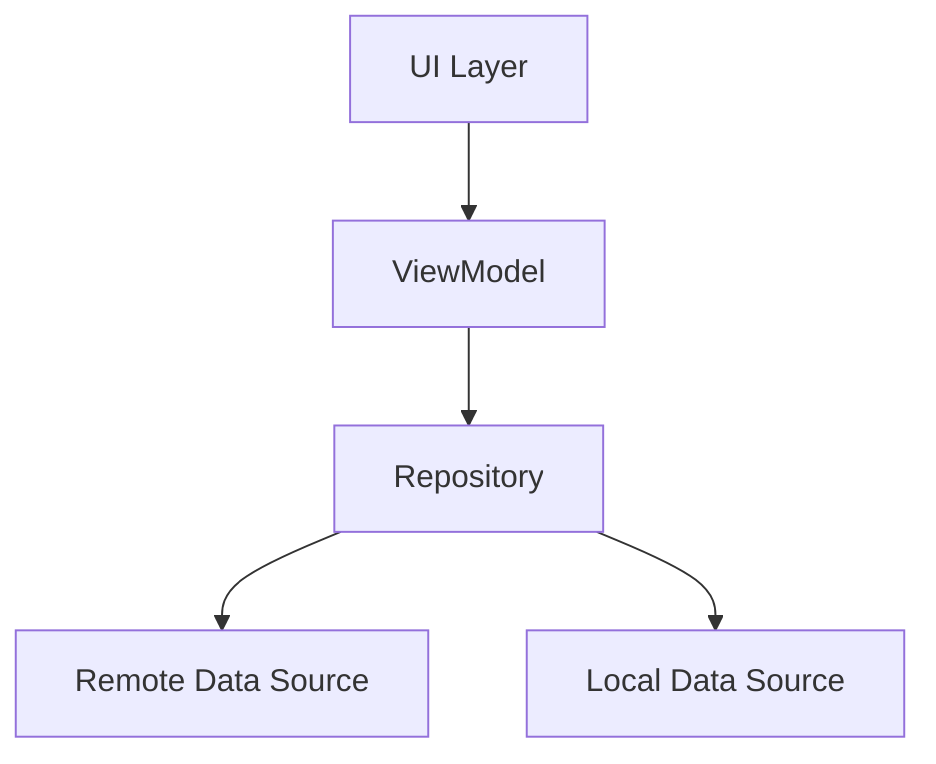

# Uber / Ride Booking

> **Status:** ⬜ Not started  
> **Key topics:** Location tracking, Maps, WebSocket, foreground services

## 1. Problem Statement

Describe the application and the problem this system needs to solve.

## 2. Requirements

### Functional Requirements
- [ ] Requirement 1
- [ ] Requirement 2
- [ ] Requirement 3

### Non-Functional Requirements
- [ ] Performance
- [ ] Reliability and availability
- [ ] Scalability
- [ ] Security and privacy
- [ ] Offline behavior (where applicable)

## 3. High-Level Architecture

Describe the proposed architecture and the responsibility of each major component.

### Architecture Diagram

_Add a Mermaid diagram or image here._

## 4. Component-Level Design

Explain the responsibilities and interactions of:
- UI and state holders
- ViewModels
- Use cases (if needed)
- Repositories
- Remote and local data sources
- Android platform components

## 5. Data Flow

Trace the important user flows from UI interaction to data source and back.

## 6. Networking & API Design

Document:
- API endpoints and request/response models
- Pagination strategy (if applicable)
- Authentication and authorization
- Error handling and retry policy
- Timeout and connectivity behavior

## 7. Database, Caching & Offline Support

Document:
- Local data model and storage choice
- Cache strategy and invalidation
- Source of truth
- Offline reads and writes
- Synchronization and conflict resolution (if applicable)

## 8. Concurrency & Background Execution

Document:
- Coroutine scopes and dispatchers
- Flow and state propagation
- Thread safety and cancellation
- WorkManager, JobScheduler, or foreground services where appropriate
- Constraints, retries, and process-death behavior

## 9. Performance & Scalability

Consider:
- Memory and CPU usage
- Rendering and recomposition
- Lazy loading and prefetching
- Image/media optimization
- Large datasets and growing traffic
- Battery and network consumption

## 10. Failure Scenarios & Edge Cases

| Scenario | Expected Behavior | Handling Strategy |
|---|---|---|
| No internet | _TBD_ | _TBD_ |
| API failure | _TBD_ | _TBD_ |
| Empty response | _TBD_ | _TBD_ |
| Process death | _TBD_ | _TBD_ |
| Duplicate user action | _TBD_ | _TBD_ |

_Add problem-specific edge cases._

## 11. Security & Privacy

Document sensitive data handling, secure storage, transport security, permissions, and abuse prevention where relevant.

## 12. Testing Strategy

- [ ] Unit tests
- [ ] Repository and data-layer tests
- [ ] Integration tests
- [ ] UI tests
- [ ] Failure and offline tests
- [ ] Performance tests (where relevant)

## 13. Architectural Decisions & Trade-offs

| Decision | Chosen Approach | Alternative | Reason / Trade-off |
|---|---|---|---|
| _TBD_ | _TBD_ | _TBD_ | _TBD_ |

## 14. Interview Follow-up Questions

1. Why did you choose this architecture?
2. What alternatives did you consider?
3. What happens when the network or a dependency fails?
4. How does the design behave under poor network conditions?
5. What changes when the dataset or user base grows significantly?
6. How would you test the critical flows?
7. What are the main limitations and trade-offs?

_Add problem-specific questions and answers._

## 15. Revision Notes

Use this section for concise notes, corrections, and things to revisit.

- **Key takeaways:**
- **Common mistakes:**
- **Topics to revisit:**
- **Last revised:** YYYY-MM-DD
